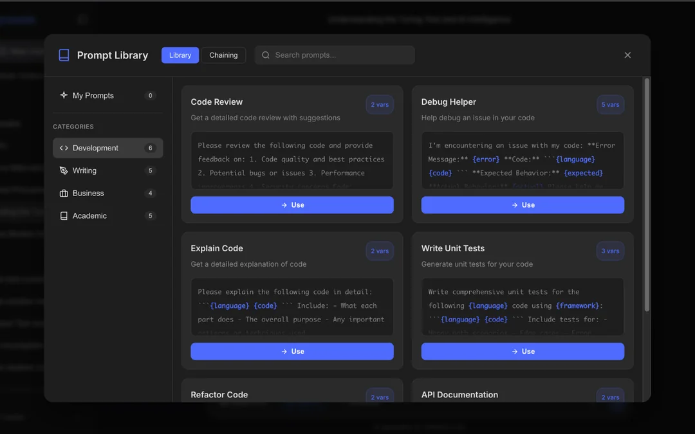
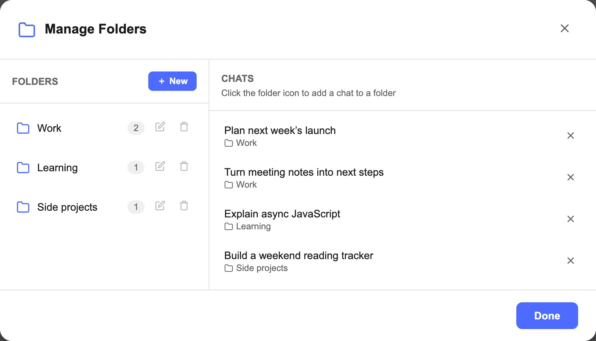

<p align="center"></p>
<h1 align="center">DeepSeek Toolbox</h1>
<p align="center"><strong>Less scrolling. Better prompts. Your chats, organized.</strong><br>Folders, bookmarks, prompt chains, and exports — right inside DeepSeek.</p>
<p align="center"><strong><a href="https://chromewebstore.google.com/detail/deepseek-folders-prompt-l/kengdooklhlonejpjiiiaeolnokhbhdf">Install from the Chrome Web Store ↗</a></strong></p>
<p align="center"><a href="#what-you-can-do">Features</a> · <a href="#try-v102">Try v1.0.2</a> · <a href="extension/">Source code</a> · <a href="PRIVACY.md">Privacy</a></p>


<p align="center"><sub>Your best prompts, ready when you need them.</sub></p>

**Free in v1.0.2.** All current features are available without a Toolbox subscription. The store currently offers v1.0.1; the v1.0.2 source here is not yet released to the store.

## What you can do

<table>
<tr><td width="50%" valign="top"><strong>📂 Give every chat a home</strong><br>Group conversations into folders for your projects, research, and everyday work.</td><td width="50%" valign="top"><strong>📌 Keep the useful parts</strong><br>Bookmark replies so good answers don’t disappear into your chat history.</td></tr>
<tr><td valign="top"><strong>📚 Reuse your best prompts</strong><br>Save templates in your prompt library and run prompt chains, one response at a time.</td><td valign="top"><strong>↗ Take your chats with you</strong><br>Export to Markdown, JSON, plain text, HTML, or a PDF print view.</td></tr>
<tr><td valign="top"><strong>🧹 Clear the clutter</strong><br>Select and delete multiple conversations together.</td><td valign="top"><strong>✨ Give your draft a boost</strong><br>Use optional AI prompt enhancement through the hosted service.</td></tr>
</table>


<p align="center"><sub>A place for every project. A shorter search for every conversation.</sub></p>

## Try v1.0.2

For the published version, use the **[Chrome Web Store](https://chromewebstore.google.com/detail/deepseek-folders-prompt-l/kengdooklhlonejpjiiiaeolnokhbhdf)**. To try this version from source:

1. Download or clone this repository.
2. Open `chrome://extensions` in Chrome or `brave://extensions` in Brave.
3. Enable **Developer mode** → **Load unpacked** → select the `extension` folder.
4. Open [DeepSeek](https://chat.deepseek.com), sign in, and find **DS-Toolbox** in the sidebar.

<details>
<summary><strong>Already using Toolbox? Keep your existing installation.</strong></summary>

Keep the existing installation and its ID to preserve saved data. Loading a different folder creates a separate installation with separate storage. For an unpacked update, update the files in the existing folder, click **Reload**, then refresh DeepSeek. Store installations should update through the store.

This release does not reset existing purchases or sessions.

</details>

## Your data stays yours

Folders, bookmarks, prompts, chains, and settings are stored in your browser. Enhancement sends the draft you choose to enhance to a hosted API and depends on that service being available. The other tools do not need the enhancement service.

The extension also checks existing membership status; feedback opens your email app. Permissions remain `storage`, `activeTab`, and `contextMenus`, with host access only to `chat.deepseek.com`. [Read the privacy details →](PRIVACY.md)

## Make it better

Found a bug? Open an issue with your browser version and steps to reproduce it. Small pull requests for fixes, translations, and usability are welcome. Keep permissions unchanged and preserve existing saved data. For security reports, use the private contact in [Privacy](PRIVACY.md).

<details>
<summary><strong>Build and test locally</strong></summary>

Use Node.js 20 or newer:

```sh
npm ci
npm test
npm run build
npm run verify
```

The build produces `dist/extension/` and `dist/deepseek-toolbox-v1.0.2.zip`. You can load the source folder directly without building. The private service backend is not needed to build or test the extension.

Optional browser tests:

```sh
npx playwright install chromium
npm run test:browser
```

Tests use a disposable profile and synthetic conversations. To use an installed Chromium-based browser, set `BROWSER_EXECUTABLE` to its executable path. The upgrade fixture models previous storage, not the full historical extension.

</details>

<details>
<summary><strong>Compatibility and future features</strong></summary>

DeepSeek can change its interface, which may break compatibility. Exports include messages currently loaded in the page; long conversations may have earlier messages unloaded. PDF export opens the browser’s print view.

Current tools are free. New hosted or premium features may be added separately in the future.

</details>

---

<p align="center"><strong>Useful to you? Give the repo a star ☆</strong><br>Help more DeepSeek users find it — and tell us what you’d like next.</p>
<p align="center"><a href="LICENSE">GPL-3.0-only</a> · Copyright © 2026 Hamza<br><sub>Independent project. Not affiliated with or endorsed by DeepSeek.</sub></p>
